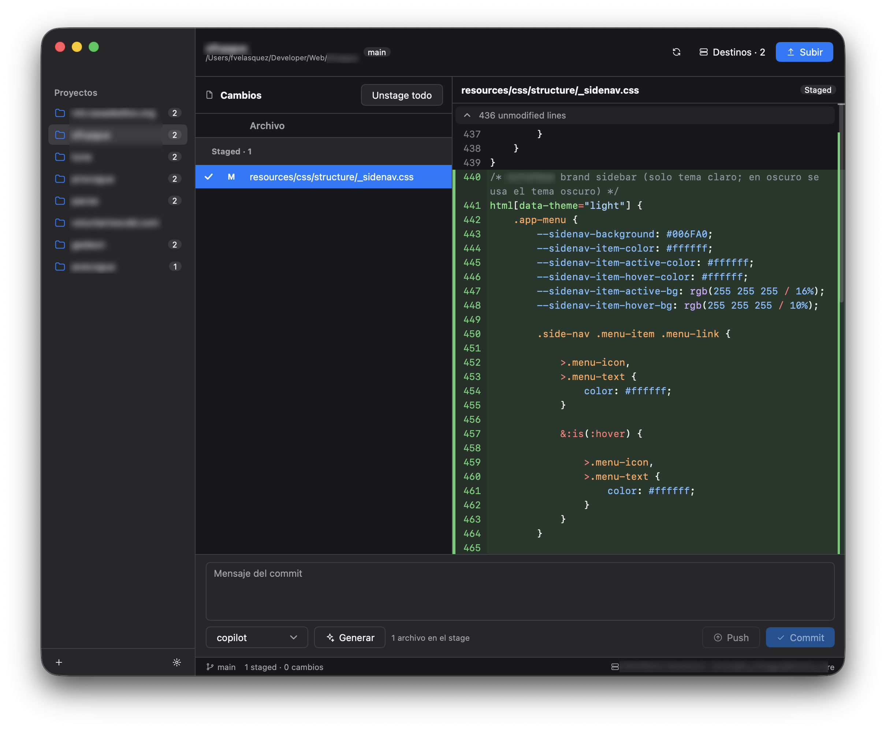
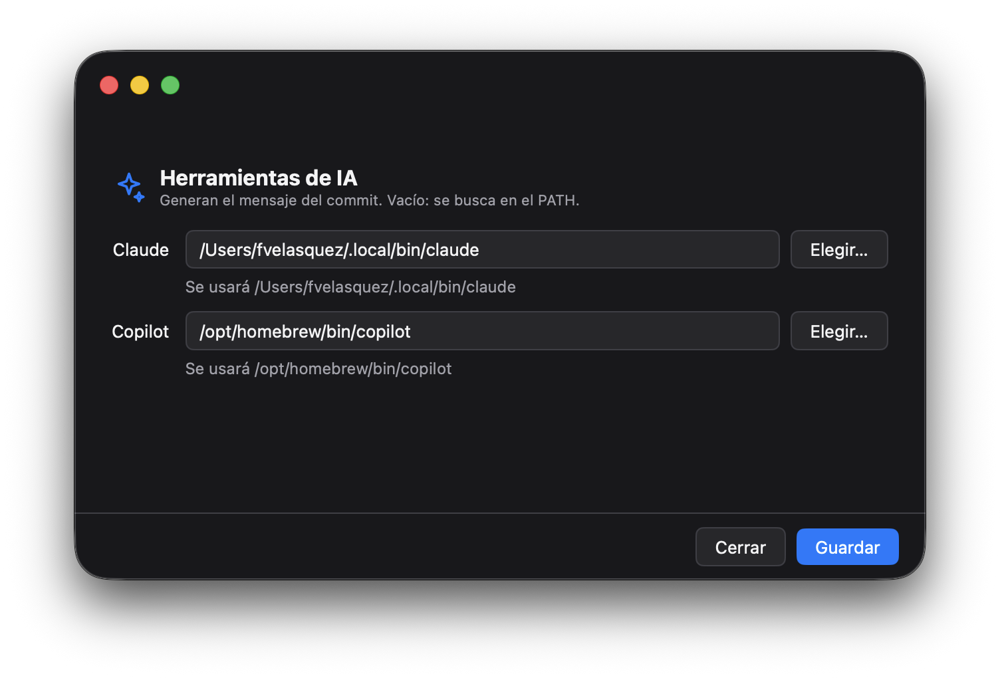
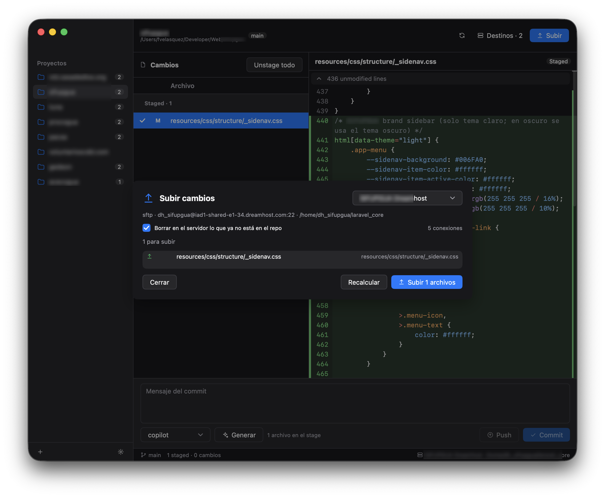
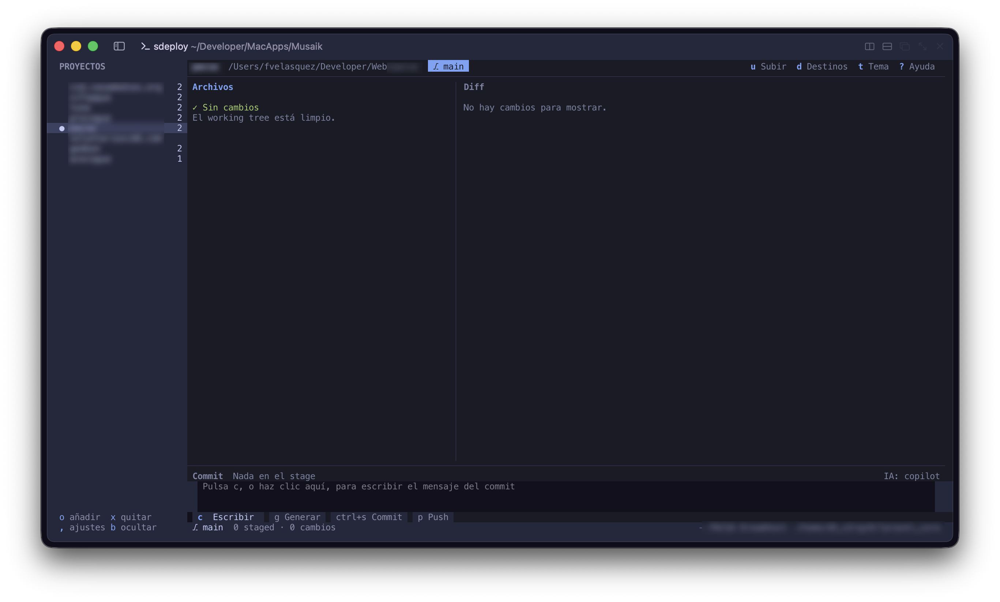

# SideDeploy

Revisa los cambios de Git, haz commit (con mensaje generado por IA si quieres) y sube los cambios por FTP/SFTP, todo desde un mismo lugar. Hay dos interfaces sobre el mismo núcleo:

| | Qué es | Tecnología |
| --- | --- | --- |
| **SideDeploy** | App nativa de macOS con ventana | Go + [MyGo](https://github.com/egoist/mygo) |
| **sdeploy** | Versión de terminal | Go + [Bubble Tea](https://github.com/charmbracelet/bubbletea) + [Lip Gloss](https://github.com/charmbracelet/lipgloss) |

Comparten los mismos datos (`projects.json`, `pro-deployer.json`, `known_hosts`) y el mismo código de Git, destinos y despliegue (`internal/`), así que un proyecto o un destino creado en una aparece en la otra. Los destinos usan el formato de `pro-deployer.json` (`.vscode/pro-deployer.json` o en la raíz del repo).

## SideDeploy (app de ventana)



- **Proyectos:** barra lateral con cada carpeta abierta; se cambia con un clic y el menú contextual la quita de la lista (no toca el disco). Abrir carpeta con ⌘O.
- **Cambios:** lista en dos secciones, *Staged* y *Cambios* (modificados, nuevos, renombrados, borrados, sin seguimiento y conflictos), con stage por archivo, «Stage todo» y «Unstage todo». Refrescar con ⌘R.
- **Diff:** unificado, con números de línea y colores; avisa en archivos binarios o de más de 2 MB.
- **Commit:** mensaje multilínea con ⌘↵; corre en segundo plano y respeta los hooks y la firma del repo (si un hook falla, muestra su salida).
- **Mensaje con IA:** lo genera Claude o Copilot desde su CLI a partir del diff del stage (o de todo el árbol si no hay nada en stage). Se copia a la caja para editarlo, nunca se commitea solo, y se puede cancelar.

  
- **Push:** botón de Push o Publicar rama en la barra de estado.
- **Destinos:** editor por proyecto para ver, añadir, editar, elegir el activo y eliminar destinos FTP/SFTP, con contraseña oculta y clave privada. Los de `pro-deployer.json` se adoptan la primera vez.
- **Subir:** sube el árbol de trabajo (staged, sin stage y sin seguimiento) al destino elegido, con lista local → remoto, progreso, errores y cancelación. Respeta `ignore`, `include`, `checkGitignore`, `autoDelete` y `concurrency`, crea las carpetas remotas y reintenta una vez cada archivo. Con `autoDelete`, borrar más de un archivo remoto pide confirmación.

  
- **SFTP seguro:** verifica la clave del host contra `~/.ssh/known_hosts` y el `known_hosts` propio de la app; un host nuevo muestra su huella y solo sube si confías en ella.
- **Ajustes (⌘,):** rutas de los ejecutables de Claude y Copilot (vacío = buscar en el `PATH`).

```sh
go tool mygo build       # genera la .app en build/
```

Los datos viven en `~/Library/Application Support/SideDeploy` (`projects.json`, con permisos 0600).

## sdeploy (terminal)



```sh
go build -o build/sdeploy ./cmd/sdeploy
build/sdeploy            # abre el último proyecto
build/sdeploy ~/sitio    # abre una carpeta
```

### Paridad con la app de ventana

| SideDeploy (ventana) | sdeploy |
| --- | --- |
| Barra lateral de proyectos, badge con nº de destinos, quitar de la lista | Panel «Proyectos» (`o` añadir, `x` quitar, `b` ocultar) |
| Lista de cambios Staged / Cambios, stage por archivo, stage todo | Panel «Archivos» (`espacio`, `a`, `A`) |
| Diff con números de línea y colores | Panel «Diff» (unificado, con contexto y desplazamiento) |
| Mensaje de commit, ⌘↵ | Cuadro de commit (`c`, `ctrl+s`) |
| Generar mensaje con Claude o Copilot | `g` / `ctrl+g`, `i` alterna la herramienta, `esc` cancela |
| Push / Publicar rama, ↑↓ en la barra de estado | `p` / `ctrl+p` |
| Destinos: lista, activo, añadir, editar, eliminar, importar de pro-deployer.json | `d` |
| Subir: destino, borrar remoto, progreso, errores, cancelar, confirmar >1 borrado, confiar en host SSH | `u` (y `sdeploy deploy` sin interfaz) |
| Ajustes: rutas de Claude y Copilot | `,` |

### Ratón

Funciona en cualquier terminal con soporte de ratón (hace falta al menos 40 columnas, y no actúa con un diálogo abierto):

- **Clic** en un panel le da el foco; en un proyecto lo abre; en un archivo lo selecciona y muestra su diff; en el cuadro de commit lo deja listo para escribir.
- **Rueda** sobre la barra de proyectos mueve la selección, sobre el diff lo desplaza y sobre la lista de archivos cambia de archivo.

### Cuadro de commit

- Escribe el mensaje a mano (`c` o clic) o genéralo con `g`; después de generarlo el foco pasa al cuadro, así puedes editar el texto antes de confirmar.
- Debajo se muestra el largo de la primera línea (`n/72`), que avisa al pasar de 72.
- Las acciones disponibles aparecen como botones con su tecla (`ctrl+s` Commit, `ctrl+g` Generar, `ctrl+p` Push) y se atenúan cuando no se pueden usar.

### Ventanas angostas

La interfaz se adapta al ancho de la terminal:

| Ancho | Qué se ve | Cómo llegar a lo que se esconde |
| --- | --- | --- |
| 100 columnas o más | proyectos, archivos y diff | `b` oculta la barra de proyectos |
| menos de 100 | se esconde la barra de proyectos | `P` abre una lista de proyectos en un diálogo |
| menos de 72 (sin contar la barra) | solo la lista de archivos | `enter` o `v` abren el diff en un diálogo; `←` `→` cambian de archivo, `s` hace stage |

Al agrandar la ventana vuelven los paneles. `tab` nunca cae en un panel escondido.

### Temas

Dracula, Tokyo Night (y Storm), Catppuccin (Mocha, Macchiato, Frappé, Latte), Nord, Gruvbox (oscuro y claro), Solarized (oscuro y claro), One Dark, Rosé Pine, Monokai, Kanagawa, Everforest y GitHub (oscuro y claro).

- `t` pasa al siguiente tema y lo guarda.
- `T` o `ctrl+t` abre el selector con vista previa en vivo (`enter` guarda, `esc` vuelve al anterior).
- `,` → Ajustes → Tema, con `←` `→`.
- `sdeploy theme` lista los temas; `sdeploy theme dracula` lo cambia; `sdeploy --theme nord` lo usa solo esa vez.

Agregar uno es una entrada más en `themes` (`theme.go`). La preferencia vive en `sdeploy.json`, junto a `projects.json`.

### Sin interfaz

```sh
sdeploy deploy --dry-run            # muestra qué se enviaría y a dónde, sin enviar
sdeploy deploy                      # el proyecto activo, su destino activo (pregunta antes)
sdeploy deploy ~/sitio --target prod --delete -y
```

Sale con 0 si todo subió, 1 si hubo errores y 130 si se canceló con ctrl+c.

### Datos

Usa la carpeta de la app de ventana (`~/Library/Application Support/SideDeploy` en macOS). `SDEPLOY_DATA` la cambia.
